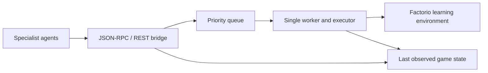

# Factorio Agent Lab

[](https://github.com/Noptus/factorio-sam-demo/actions/workflows/tests.yml)

An AI-assisted integration prototype for agents sharing one Factorio world. Specialists propose actions; a priority-scheduled broker serializes calls into the game. A small JSON-RPC tool bridge exposes execution and state reads to agent clients.

The engineering question is how independent agents can coordinate around a stateful environment without repeating uncertain actions or overlapping writes.

## Run the offline checks

Python 3.12 is tested. No game, credentials, Solace broker or hosted-model calls are needed.

```bash
git clone https://github.com/Noptus/factorio-sam-demo.git
cd factorio-sam-demo
python -m venv .venv
source .venv/bin/activate
python -m pip install -r requirements-dev.txt
python -m pytest -q
```

Tests exercise the actual HTTP broker with a fake game, priority ordering, FIFO ties, exception recovery, timeout behavior, repeated startup/shutdown, result normalization and bridge discovery.

## Architecture



| Component | Responsibility |
| --- | --- |
| [Action broker](action_broker/broker.py) | Validate requests, queue actions and serialize game calls |
| [Priorities](action_broker/priority.py) | Emergency, high, normal and background work; FIFO within a priority |
| [Client](action_broker/client.py) | Async submission, result polling and state reads |
| [Tool bridge](mcp_server/factorio_mcp.py) | A small MCP-style JSON-RPC subset and REST tool endpoints |
| [Agent prompts](agents/) | Proposed responsibilities for planning, resources, logistics, building and reflection |
| [Task definitions](tasks/lab_play_tasks.yaml) | Task goals for future live evaluation |

## Failure semantics

A game call can mutate state before raising an exception. Actions are therefore **never automatically retried**. An error sets `execution_uncertain`; the caller must inspect state before deciding what to do next.

A timeout is a deadline for reporting a result, not a way to kill a Python thread or undo game effects. The broker reports uncertainty and waits for the original call to finish before taking the next queued action. A permanently hung call stalls the worker. Process isolation and reconciliation are future work; restarting the service does not guarantee cancellation at the external game server.

The queue accepts at most `MAX_QUEUE_DEPTH` pending actions (default 100); a full queue rejects new requests with HTTP 429 before accepting an action.

Results, queue state and the observation cache live in memory and reset on startup. The cache reflects the last action observation, not a continuously refreshed view. Queue depth at submission is not a guaranteed execution position; later higher-priority work can overtake it.

## Live integration

Live use needs a compatible licensed Factorio/FLE installation, Solace Agent Mesh, a broker and model access. Review [requirements.txt](requirements.txt), [.env.example](.env.example) and [the proposed agent configuration](configs/sam_config.yaml) against the versions you actually install. The complete agent/game journey has **not** been verified by the offline suite.

The local service entry points are:

```bash
uvicorn action_broker.broker:app --host 127.0.0.1 --port 8765
uvicorn mcp_server.factorio_mcp:app --host 127.0.0.1 --port 8766
```

The bridge forwards code execution to a game environment. Run it only with trusted local clients. It has no authentication or remote-code sandbox; model-provider calls can incur charges. Configuration reads this repository's `.env`, which is ignored by Git.

## Evidence and next work

There is no completed Factorio benchmark or measured multi-agent improvement. Next steps are an end-to-end compatibility test, a recorded fixed-task baseline, bounded result storage, and a recovery protocol for uncertain outcomes. Specialist prompts and task lists are design inputs, not benchmark results.
